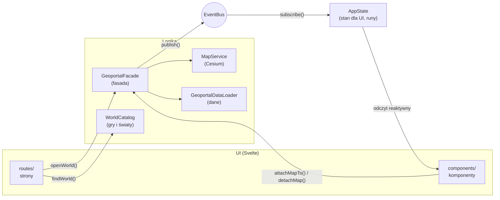
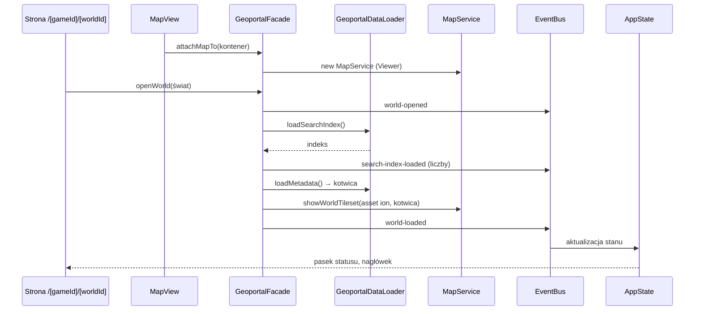

# Architektura

Aplikacja to statyczna strona (SvelteKit, `adapter-static`) działająca wyłącznie w przeglądarce.
Kod dzieli się na warstwy, które znają się tylko w jednym kierunku: **UI nie zna logiki biznesowej,
a logika nie zna UI**. Łączy je fasada (polecenia) i event bus (wyniki).

## Warstwy

| Warstwa    | Folder                                 | Odpowiedzialność                                              | Czego nie robi                                                                   |
| ---------- | -------------------------------------- | ------------------------------------------------------------- | -------------------------------------------------------------------------------- |
| Strony     | `src/routes/`                          | adresy, odczyt parametrów, wybór świata z katalogu            | nie wczytuje danych, nie dotyka Cesium                                           |
| Komponenty | `src/lib/components/`                  | renderowanie stanu, zgłaszanie intencji użytkownika do fasady | nie importuje `cesium`, `minisearch`, `services/`, `data/` (pilnuje tego ESLint) |
| Fasada     | `src/lib/services/geoportal-facade.ts` | jedyne wejście UI do logiki; koordynuje serwisy               | nie zwraca wyników bezpośrednio — publikuje zdarzenia                            |
| Serwisy    | `src/lib/services/`                    | mapa 3D (`MapService`), budowniczy opcji Viewera              | nie znają Svelte                                                                 |
| Dane       | `src/lib/data/`                        | typy, parsowanie i walidacja paczki danych, katalog światów   | nie znają Cesium ani UI                                                          |
| Zdarzenia  | `src/lib/events/`                      | typowany event bus i lista zdarzeń aplikacji                  | —                                                                                |
| Stan       | `src/lib/state/`                       | reaktywny stan dla UI, aktualizowany wyłącznie zdarzeniami    | nie trzyma obiektów Cesium                                                       |

Zależności składa jedno miejsce: `src/lib/composition-root.ts`. Komponenty i strony importują stamtąd
gotowe instancje (`geoportal`, `appState`, `worldCatalog`).

## Przepływ: otwarcie świata

Kolejność `attachMapTo` i `openWorld` nie ma znaczenia — fasada pokaże świat, gdy ma oba.
Każde wczytanie świata dostaje numer pokolenia; wynik wyprzedzonego wczytania (szybka zmiana świata,
odpięcie mapy) jest pomijany, a niepotrzebny tileset niszczony.

## Zdarzenia

Lista w `src/lib/events/app-events.ts`. Zdarzenie to obiekt z polem `type` (unia dyskryminowana),
więc `subscribe('world-load-failed', ({ message }) => …)` ma pełne typy bez asercji.

| Zdarzenie                    | Dane                                                                    | Kiedy                                                                       |
| ---------------------------- | ----------------------------------------------------------------------- | --------------------------------------------------------------------------- |
| `world-opened`               | `worldName`, `localCoordinateSystemName`                                | fasada przełączyła świat                                                    |
| `world-load-started`         | —                                                                       | start wczytywania modelu świata                                             |
| `world-loaded`               | —                                                                       | tileset świata dodany do sceny                                              |
| `world-load-failed`          | `message`                                                               | błąd wczytywania modelu świata (np. brak sieci)                             |
| `search-index-load-started`  | —                                                                       | start wczytywania indeksu                                                   |
| `search-index-loaded`        | `counts`                                                                | indeks wczytany; liczba przedmiotów i postaci                               |
| `search-index-load-failed`   | `message`                                                               | błąd pobrania lub walidacji indeksu                                         |
| `tool-selected`              | `toolId` lub `null`                                                     | otwarto albo zamknięto narzędzie na szynie                                  |
| `cursor-moved`               | `position` (E, N, H, lon, lat) lub `null`                               | kursor nad terenem (najwyżej raz na klatkę)                                 |
| `camera-heading-changed`     | `headingDegrees`                                                        | obrót kamery — kompas                                                       |
| `map-scale-changed`          | `metresPerPixel` lub `null`                                             | zmiana skali w środku ekranu — podziałka                                    |
| `coordinate-system-changed`  | `systemId`                                                              | zmiana układu współrzędnych w pasku przyrządu                               |
| `search-results-changed`     | `query`, `typeFilter`, `results`                                        | zmiana zapytania, filtra albo wczytanie indeksu                             |
| `search-entry-selected`      | `details` lub `null`                                                    | wybrano wpis (karta szczegółów, znaczniki na mapie) albo wrócono do wyników |
| `data-layers-changed`        | `layers` (nazwa, kolor, liczność, stan)                                 | włączenie, wczytywanie albo błąd warstwy danych                             |
| `data-layer-load-failed`     | `layerName`, `message`                                                  | nie udało się pobrać lub sprawdzić pliku warstwy                            |
| `feature-identified`         | `identification` lub `null`                                             | kliknięto punkt warstwy (karta informacji) albo puste miejsce               |
| `analysis-changed`           | `analysis` (tryb, temat, punkt odniesienia, wyniki)                     | zmiana tematu, punktu albo wyniku analizy w narzędziu Analizy               |
| `camera-view-changed`        | `view` (E, N, H, kierunek, nachylenie) lub `null`                       | kamera się zatrzymała (`moveEnd`) albo odtworzono widok z linku             |
| `bookmarks-changed`          | `bookmarks`, `hasStorageError`                                          | wczytano, dodano albo usunięto zakładkę (lista dotyczy otwartego świata)    |
| `measurement-changed`        | `measurement` (tryb, wierzchołki, podsumowanie, profil, wskazany punkt) | kliknięcie mapy w narzędziu Pomiary, wynik profilu terenu, wyczyszczenie    |
| `chapter-changed`            | `chapter` (1–6) lub `null`                                              | wybór rozdziału w panelu Czas albo odtworzenie go z linku lub zakładki      |
| `time-of-day-changed`        | `minuteOfDay`, `routineLayerStatus`, `charactersOnMap`                  | zmiana pory dnia albo warstwy postaci o tej godzinie                        |
| `app-installability-changed` | `canInstall`                                                            | przeglądarka pozwala zainstalować aplikację albo instalacja się zakończyła  |
| `static-objects-changed`     | `status`, `errorMessage`                                                | włączenie, wczytywanie albo błąd warstwy obiektów świata                    |

## Cesium a reaktywność Svelte

Obiektów Cesium (`Viewer`, `Cesium3DTileset`, kolekcje) **nie trzymamy w `$state`** — proxy Svelte
psuje ich wewnętrzne mechanizmy. Żyją w zwykłych polach `MapService`. Reaktywne są tylko dane
aplikacji w `AppState`.

## Wzorce

- **Fasada** — `GeoportalFacade`: prosty interfejs (`openWorld`, `attachMapTo`, `detachMap`) zamiast
  wielu serwisów.
- **Budowniczy** — `ViewerOptionsBuilder`: czytelne składanie opcji Viewera
  (`withoutIonBaseLayer().withoutToolbarWidgets()…`).
- **Obserwator** — `EventBus`: wyniki płyną od logiki do stanu bez wzajemnej znajomości.
- **Korzeń kompozycji** — `composition-root.ts`: jedno miejsce tworzenia i łączenia obiektów;
  zależności przekazywane konstruktorem, co ułatwia testy.

## Geodezja

`WorldFrame` przelicza punkt sceny Cesium na pozycję w świecie: E/N/H w metrach od kotwicy oraz lon/lat.
`CoordinateFormatter` pokazuje ją w jednym z układów: **Układ Khorinis 1992** (metry), **jednostki gry**
(centymetry silnika: x = E, y = H, z = −N — te same co w komendzie Marvina `goto pos`) albo **WGS 84**.

## Wyszukiwanie

`SearchCoordinator` (wywoływany przez fasadę) trzyma zapytanie, filtr i wybrany wpis jednego świata.
`SearchService` to indeks MiniSearch: pola nazwa, kategoria (z nazwą gildii zamiast kodu, np. VLK →
Mieszczanin) i kod; wyszukiwanie po początku słowa, z tolerancją literówek w dłuższych słowach i bez
polskich znaków (`normalizeSearchTerm`). `SearchEntryPresenter` zamienia wpisy na teksty dla UI,
a `PlaceMarkersLayer` rysuje miejsca wybranego wpisu jako jedną kolekcję punktów Cesium.

Wybrany wpis jest w adresie: `/g2nk/khorinis?wpis=item:ITPL_PERM_HERB`. Wpis z linku czeka na
wczytanie indeksu, a po wczytaniu modelu świata kamera leci do jego miejsc.

## Warstwy danych i identyfikacja

`DATA_LAYERS` (`services/layers/data-layer-catalog.ts`) opisuje warstwy: przedmioty w świecie, skrzynie,
unikatowe postacie, wszyscy NPC — plik GeoJSON, kolor, parser właściwości i opis obiektu do karty.
`DataLayersCoordinator` pobiera plik dopiero przy pierwszym włączeniu warstwy i go zapamiętuje.
Każdy obiekt ma `iconId` (`services/layers/map-icons.ts`): ikona przedmiotu wynika z jego kategorii
(rośliny, jedzenie, broń…), skrzynia i postać mają własne. Warstwa z ikonami jest rysowana jako
`BillboardCollection` z SVG (kształty z Lucide, licencja ISC, w `services/layers/map-icon-shapes.ts`,
generowane z pakietu `@lucide/svelte`) w kolorze warstwy i z ciemną obwódką; warstwa bez ikon zostaje
kolekcją punktów. Warstwa „postacie o tej godzinie” też rysuje ikony postaci. Kształty ikon są danymi
(`MapIconNode`), więc ten sam zestaw służy legendzie w panelu Warstwy (`DataLayerView.legend`) bez
importowania logiki do komponentu.
`DataLayersRenderer` rysuje każdą warstwę jako kolekcję, której identyfikatorem jest
`{ layerId, featureIndex }`; kliknięcie mapy (`MapViewObserver` → `onMapClicked`) wskazuje obiekt
w danych bez dodatkowych map, a fasada publikuje `feature-identified`.

## Pomiary

Gdy aktywne jest narzędzie Pomiary, fasada kieruje kliknięcia mapy do `MeasurementCoordinator`
zamiast do identyfikacji. Tryb **Odległość** zbiera wierzchołki łamanej; `MeasurementCalculator`
liczy odległość w poziomie i w przestrzeni, a profil terenu powstaje z próbek co ~2 m rzutowanych
na model świata (`MapService.sampleTerrainUnder` → `clampToHeightMostDetailed`). Model zawiera drzewa
i dachy, więc przed liczeniem profilu wysokości przechodzą przez filtr medianowy
(`removeNarrowObstacles`), który usuwa wąskie przeszkody; gęsty las nadal może podnieść profil.
Tryb **Pole** zbiera wierzchołki wielokąta; od trzech `MeasurementCalculator.summarizePolygon` liczy pole
w rzucie na płaszczyznę poziomą (wzór Gaussa, wynik w m² i ha) oraz obwód, a obrys domyka się i idzie
po terenie jak linia odległości.
Tryb **Współrzędne** pokazuje wskazany punkt we wszystkich układach i komendę Marvina `goto pos`.

## Analizy

Gdy aktywne jest narzędzie Analizy, kliknięcie mapy ustawia punkt odniesienia w `AnalysisCoordinator`
(zamiast identyfikować obiekt). Temat analizy (przedmiot albo postać) wybiera się spośród wpisów
indeksu — koordynator korzysta z tego samego `SearchService` co wyszukiwarka. **Najbliższe**: miejsca
tematu rzutuje `LocalProjector` na ramę świata (E, N, H), a `NearestPlacesFinder` wybiera pięć
najbliższych po prostej w przestrzeni (z odległością w poziomie). `AnalysisRenderer` rysuje punkt,
połączenia i numerowane wyniki; kliknięcie wiersza przelatuje kamerą do miejsca. **Zasięg**: punkt i promień (10–300 m); `BufferAnalyzer` zlicza w kole (w poziomie)
przedmioty, skrzynie i wszystkich NPC z warstw danych (`DataLayersCoordinator.loadLayerFeatures` pobiera
plik bez pokazywania warstwy) i grupuje je po nazwie; okrąg na mapie idzie po terenie (próbkowanie
wysokości jak w profilu pomiaru). **Zagęszczenie**: `DensityGridBuilder` dzieli miejsca tematu na siatkę sześciokątną (rozmiar =
odległość między równoległymi bokami) albo kwadratową i zlicza sztuki w niepustych komórkach;
kolor komórki wynika z legendy (równe przedziały, najwyżej pięć, ciepła skala rdza → żar → mosiądz →
jasny żar). `AnalysisRenderer` rysuje komórki jako jeden prymityw z `depthFailAppearance`, żeby
nie znikały pod terenem na zboczach; w tym trybie kliknięcie mapy nie ustawia punktu.
**Widoczność**: punkt i promień (30–300 m); `ViewshedCalculator` buduje siatkę biegunową (promienie co 3°,
pierścienie co ok. 6 m), koordynator odczytuje wysokość modelu pod próbkami
(`MapService.sampleTerrainUnderKeepingOrder`), a kalkulator metodą horyzontu (kąt wzniesienia z oka
obserwatora na wysokości 1,7 m ponad klikniętym punktem) oznacza każdą komórkę jako widoczną albo
zasłoniętą. Wynik rysuje `AnalysisRenderer.showViewshed` (zielone i rdzawe komórki), a panel podaje udział
widocznego pola. Próbkowany jest model świata razem z budynkami i drzewami, więc one też zasłaniają. Uzasadnienie podziału
na czyste klasy i renderer: [ADR 0006](adr/0006-analizy-na-czystych-klasach-i-lokalnym-rzucie.md).

## Widok w adresie i zakładki

Stan widoku to cztery rzeczy: wybrany wpis, kamera, otwarte narzędzie i rozdział. `ViewLinkCodec` zamienia je na
parametry adresu i z powrotem: `?wpis=item:…&widok=E_N_H_kierunek_nachylenie&narzedzie=measure&rozdzial=3`
(parametry domyślne są pomijane, zamknięty panel to `narzedzie=zamkniete`). Kamerę koduje
`CameraViewCodec` w metrach od kotwicy i stopniach, więc link nie zależy od globusa Cesium; uszkodzony
parametr jest ignorowany, a reszta widoku odtwarzana.

Strona (`+page.svelte`) tylko przekazuje fasadzie surowe `location.search` (`openSharedView`) i po każdej
zmianie `AppState.sharedViewQuery` podmienia adres (`replaceState`). `MapViewObserver` zgłasza zatrzymanie
kamery (`camera.moveEnd`), fasada publikuje `camera-view-changed`. Widok z linku czeka na wczytanie modelu
świata (kamera) i indeksu (wpis); gdy link ma kamerę, wpis nie przelatuje do swoich miejsc.

`BookmarksCoordinator` trzyma zakładki otwartego świata, a `BookmarkStore` zapisuje je w `localStorage`
(klucz `gisofgothic:bookmarks:v1`, lista JSON). Odczyt waliduje każdy wpis; niedostępna albo pełna pamięć
nie przerywa działania — panel pokazuje ostrzeżenie. Zakładka zapamiętuje to samo co link, więc „Kopiuj
link” składa adres z `linkQuery` zakładki. Decyzje: [ADR 0007](adr/0007-widok-w-adresie-i-zakladki-w-localstorage.md).

## Kadrowanie kamery

Panele zasłaniają część mapy, więc przeloty kamery nie mogą stawiać celu w środku całego płótna.
`MapInsetsReporter` (komponent bez znaczników) mierzy elementy z `data-map-obstacle` — szynę i panel
narzędzia — i zgłasza fasadzie `reserveMapSpace({ leftPixels, bottomPixels })`: na komputerze panel
z lewej, na telefonie arkusz od dołu. `CameraFramer` przesuwa kamerę w bok i w górę, tak by cel wypadł
w środku wolnego obszaru (`FreeAreaCalculator`), a przy dopasowaniu do wielu znaczników oddala ją
proporcjonalnie do zasłoniętej części. Przez `CameraFramer` idą przeloty do znaczników i miejsc wpisu,
do wyników analiz i do całego świata; widok z linku albo zakładki to dokładna pozycja kamery. Przy
`prefers-reduced-motion` przeloty są natychmiastowe. Decyzja: [ADR 0008](adr/0008-kadrowanie-kamery-z-marginesem-na-panele.md).

## Arkusz mobilny

Na telefonie panel narzędzia (`ToolPanel`) jest arkuszem z uchwytem i trzema stanami: zwinięty, połowa,
pełny. Stan i trwające przeciąganie trzyma `MobileSheetState` (`mobileSheet` w `composition-root.ts`) —
to stan interfejsu, który nie trafia do fasady; wybór narzędzia (`tool-selected`) otwiera arkusz do połowy.
Wysokości i wybór stanu po puszczeniu uchwytu liczy czysta klasa `SheetHeightResolver`. `MapInsetsReporter`
mierzy rzeczywistą wysokość arkusza, więc po każdej zmianie stanu (i po animacji wysokości) kadrowanie kamery
widzi aktualny zasłonięty dół. Decyzja: [ADR 0009](adr/0009-wlasny-arkusz-mobilny-zamiast-drawera.md).

## Podgląd modelu przedmiotu

Karta wpisu przedmiotu z modelem pokazuje mały podgląd 3D. Komponent tylko oznacza kontener (`{@attach}`)
i wywołuje `GeoportalFacade.showModelPreview`, a `ModelPreview` (`services/map/`) tworzy osobny
`CesiumWidget` bez globusa i nieba, ładuje model w osiach modeli świata i ustawia kamerę wokół
jego `boundingSphere`. Obracanie i zoom myszą lub palcem; zamknięcie karty niszczy widget.

Modele są chronione przed pobraniem ([ADR 0012](adr/0012-ochrona-modeli-przedmiotow.md)). Karta zna
tylko logiczną ścieżkę modelu (`modelPath`, np. `g2nk/khorinis/previews/x.glb`). `ProtectedModelLoader`
(`services/models/`) liczy z niej nazwę pliku (HMAC), pobiera zaszyfrowany plik z bramki modeli
(adres `protectedModelsUrl` w katalogu światów) i odszyfrowuje go w pamięci (`ProtectedModelCodec`);
`ModelPreview` podaje bajty do Cesium przez `InMemoryModelResource`, bez żadnego adresu pliku.

Przedmioty w grze leżą na ziemi, więc modele są płaskie. Wymiary zapisane w chronionym pliku
trafiają do `PreviewOrientationChooser`, który dobiera ułożenie:

- naturalne proporcje (rośliny, mikstury) — bez zmian;
- płaski i długi (broń, łuki, pochodnie) — obrót o 90°, oś długości pionowo, głowica (strona −x)
  u góry, kamera prawie z boku i dalej, żeby wysoki przedmiot mieścił się w kadrze;
- płaski, ale szeroki (pancerze złożone w kupkę, amulety, zwoje) — leży, kamera patrzy z góry.

Brak wymiarów oznacza podgląd bez obrotu.

## Obiekty świata (voby)

`StaticObjectsCoordinator` (`services/layers/`) obsługuje warstwę „Obiekty świata” w panelu Warstwy:
wszystkie statyczne voby danego świata (drzewa, budynki, rekwizyty i przedmioty leżące na ziemi) jako
osobny tileset 3D Tiles z Cesium ion, podawany przez bramkę zasobów (`staticObjectsTilesetUrl`
w katalogu światów). `MapService.showStaticObjectsTileset` ustawia go tą samą macierzą kotwicy co
model świata i działa dopiero po jego wczytaniu. Warstwa jest domyślnie wyłączona, wczytuje się
przy pierwszym włączeniu, a zmiana świata ją wyłącza. Stan publikuje zdarzenie `static-objects-changed`.

## Pora dnia

`TimeCoordinator` trzyma minutę doby (domyślnie 12:00). `MapService.showTimeOfDay` ustawia światło
kierunkowe: słońce od wschodu (6:00) przez południe do zachodu (18:00), nocą słabsze, chłodne światło.
Cienie (`MapService.showShadows`) są domyślnie wyłączone; mapa cieni Cesium korzysta z kierunku światła
sceny, więc cienie podążają za porą dnia. Gładkie cienie to `softShadows` i mapa 4096 px zamiast 2048 px.
Warstwa „postacie o tej godzinie” czyta `character_places.geojson` przy pierwszym włączeniu, bierze
tylko rutyny domyślne i przez `DailySchedule` wybiera miejsca, których przedział godzin obejmuje
wybraną minutę (przedziały przez północ, np. „22:00–07:00”, są obsługiwane).

## Rozdział

`GeoportalFacade.selectChapter` zapamiętuje wybrany rozdział I–VI (`null` = wszystkie, domyślnie) i podaje
`ChapterFilter` (`services/chapters/`) koordynatorom `DataLayersCoordinator` i `TimeCoordinator`; publikuje
`chapter-changed`. Semantyka: wstawienie postaci ma `chapter` (numer rozdziału funkcji skryptu) albo `null`
(start świata lub dialog). W rozdziale N widać postacie z `chapter` ≤ N lub `null`, bo dane nie mówią o
znikaniu postaci. Filtr dotyczy warstw „Unikatowe postacie” i „Wszyscy NPC” (`isFilteredByChapter` w
`DATA_LAYERS`) oraz warstwy „postacie o tej godzinie”: rutyny nie mają rozdziału, więc `SpawnChapterIndex`
(z `npcs.geojson`, pobieranego razem z rutynami) daje im najwcześniejszy rozdział wstawienia postaci o tym
`npc_code`. Rozdział trafia do adresu (`rozdzial=1…6`) i do zakładek (`SavedView.chapter`).

## PWA

Aplikację da się zainstalować (manifest, ikony, service worker) i działa bez sieci — poza modelem
świata z Cesium ion. Service worker (`src/service-worker/index.ts`, klasa `AppServiceWorker`) przy
instalacji zapisuje powłokę (pliki z hashem, ikony, manifest, stronę startową), a żądania obsługuje
według `CachingPolicy` (`services/pwa/`): strony najpierw z sieci, pliki z hashem i zasoby Cesium
najpierw z pamięci, dane świata z pamięci z odświeżeniem w tle; plików z bramki zasobów (kafle świata, modele przedmiotów) nie dotyka.
`AppInstallation` przechwytuje `beforeinstallprompt` i publikuje `app-installability-changed`;
pasek górny pokazuje wtedy przycisk „Zainstaluj”. Szczegóły i pułapki: [ADR 0011](adr/0011-pwa-z-wlasnym-service-workerem.md).
