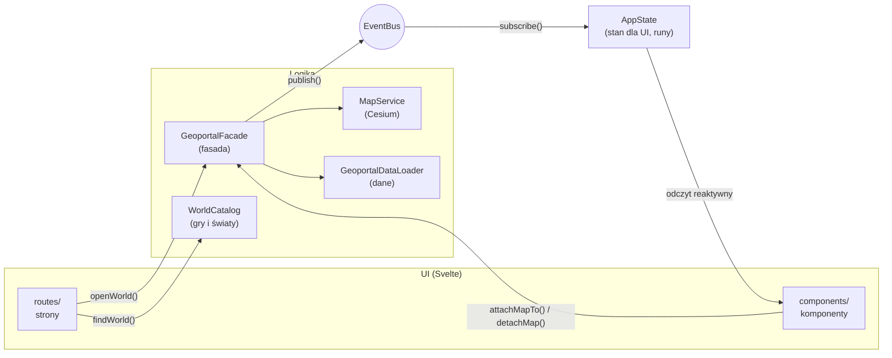
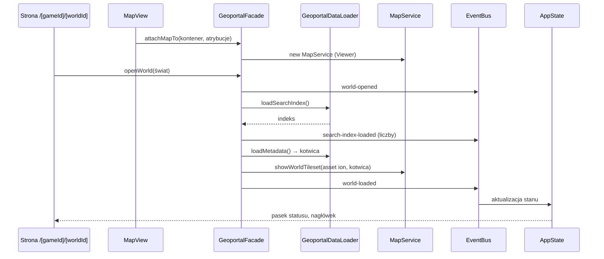

# Architektura

Aplikacja to statyczna strona (SvelteKit, `adapter-static`) działająca wyłącznie w przeglądarce.
Kod dzieli się na warstwy, które znają się tylko w jednym kierunku: **UI nie zna logiki biznesowej,
a logika nie zna UI**. Łączy je fasada (polecenia) i event bus (wyniki).

## Warstwy

| Warstwa    | Folder                                 | Odpowiedzialność                                              | Czego nie robi                                                                   |
| ---------- | -------------------------------------- | ------------------------------------------------------------- | -------------------------------------------------------------------------------- |
| Strony     | `src/routes/`                          | adresy, odczyt parametrów, wybór świata z katalogu            | nie wczytuje danych, nie dotyka Cesium                                           |
| Komponenty | `src/lib/components/`                  | renderowanie stanu, zgłaszanie intencji użytkownika do fasady | nie importuje `cesium`, `minisearch`, `services/`, `data/` (pilnuje tego ESLint) |
| Fasada     | `src/lib/services/geoportal-facade.ts` | jedyne wejście UI do logiki; koordynuje serwisy               | nie zwraca wyników bezpośrednio — publikuje zdarzenia                            |
| Serwisy    | `src/lib/services/`                    | mapa 3D (`MapService`), budowniczy opcji Viewera              | nie znają Svelte                                                                 |
| Dane       | `src/lib/data/`                        | typy, parsowanie i walidacja paczki danych, katalog światów   | nie znają Cesium ani UI                                                          |
| Zdarzenia  | `src/lib/events/`                      | typowany event bus i lista zdarzeń aplikacji                  | —                                                                                |
| Stan       | `src/lib/state/`                       | reaktywny stan dla UI, aktualizowany wyłącznie zdarzeniami    | nie trzyma obiektów Cesium                                                       |

Zależności składa jedno miejsce: `src/lib/composition-root.ts`. Komponenty i strony importują stamtąd
gotowe instancje (`geoportal`, `appState`, `worldCatalog`).

## Przepływ: otwarcie świata

Kolejność `attachMapTo` i `openWorld` nie ma znaczenia — fasada pokaże świat, gdy ma oba.
Każde wczytanie świata dostaje numer pokolenia; wynik wyprzedzonego wczytania (szybka zmiana świata,
odpięcie mapy) jest pomijany, a niepotrzebny tileset niszczony.

## Zdarzenia

Lista w `src/lib/events/app-events.ts`. Zdarzenie to obiekt z polem `type` (unia dyskryminowana),
więc `subscribe('world-load-failed', ({ message }) => …)` ma pełne typy bez asercji.

| Zdarzenie                    | Dane                                                                                     | Kiedy                                                                                             |
| ---------------------------- | ---------------------------------------------------------------------------------------- | ------------------------------------------------------------------------------------------------- |
| `world-opened`               | `worldName`, `localCoordinateSystemName`, `hasChapters`, `hasApproximateRoutineTimes`    | fasada przełączyła świat                                                                          |
| `world-load-started`         | —                                                                                        | start wczytywania modelu świata                                                                   |
| `world-loaded`               | —                                                                                        | tileset świata dodany do sceny                                                                    |
| `world-load-failed`          | `message`                                                                                | błąd wczytywania modelu świata (np. brak sieci)                                                   |
| `search-index-load-started`  | —                                                                                        | start wczytywania indeksu                                                                         |
| `search-index-loaded`        | `counts`                                                                                 | indeks wczytany; liczba przedmiotów i postaci                                                     |
| `search-index-load-failed`   | `message`                                                                                | błąd pobrania lub walidacji indeksu                                                               |
| `tool-selected`              | `toolId` lub `null`                                                                      | otwarto albo zamknięto narzędzie na szynie                                                        |
| `cursor-moved`               | `position` (E, N, H, lon, lat) lub `null`                                                | kursor nad terenem (najwyżej raz na klatkę)                                                       |
| `camera-heading-changed`     | `headingDegrees`                                                                         | obrót kamery — kompas                                                                             |
| `map-scale-changed`          | `metresPerPixel` lub `null`                                                              | zmiana skali w środku ekranu — podziałka                                                          |
| `coordinate-system-changed`  | `systemId`                                                                               | zmiana układu współrzędnych w pasku przyrządu                                                     |
| `search-results-changed`     | `query`, `typeFilter`, `results`                                                         | zmiana zapytania, filtra albo wczytanie indeksu                                                   |
| `search-entry-selected`      | `details` lub `null`                                                                     | wybrano wpis (karta szczegółów, znaczniki na mapie) albo wrócono do wyników                       |
| `data-layers-changed`        | `layers` (nazwa, kolor, liczność, stan)                                                  | włączenie, wczytywanie albo błąd warstwy danych                                                   |
| `data-layer-load-failed`     | `layerName`, `message`                                                                   | nie udało się pobrać lub sprawdzić pliku warstwy                                                  |
| `feature-identified`         | `identification` lub `null`                                                              | kliknięto punkt warstwy (karta informacji) albo puste miejsce                                     |
| `analysis-changed`           | `analysis` (tryb, temat, punkt odniesienia, wyniki)                                      | zmiana tematu, punktu albo wyniku analizy w narzędziu Analizy                                     |
| `camera-view-changed`        | `view` (E, N, H, kierunek, nachylenie) lub `null`                                        | kamera się zatrzymała (`moveEnd`) albo odtworzono widok z linku                                   |
| `camera-projection-changed`  | `projection` (perspektywa z FOV albo ortogonalny), `fieldOfViewDegrees`                  | wybór rzutu, zmiana kąta widzenia albo odtworzenie rzutu z linku lub zakładki                     |
| `view-mode-changed`          | `mode` (`view-3d` albo `view-2d`), `sliceHeightMetres` lub `null`                        | wejście w tryb 2D albo wyjście z niego, zmiana wysokości cięcia, odtworzenie z linku lub zakładki |
| `slice-height-range-changed` | `range` (`minimumMetres`, `maximumMetres`) lub `null`                                    | po wczytaniu modelu świata (zakres suwaka cięcia wynika z granic modelu)                          |
| `map-overlays-changed`       | `overlays` (`areContoursVisible`, `isGridVisible`)                                       | przełączenie poziomic albo siatki w panelu Warstwy                                                |
| `bookmarks-changed`          | `bookmarks`, `hasStorageError`                                                           | wczytano, dodano albo usunięto zakładkę (lista dotyczy otwartego świata)                          |
| `measurement-changed`        | `measurement` (tryb, wierzchołki, podsumowanie, profil, czasy przejścia, wskazany punkt) | kliknięcie mapy w narzędziu Pomiary, wynik profilu terenu, wyczyszczenie                          |
| `chapter-changed`            | `chapter` (1–6) lub `null`                                                               | wybór rozdziału w panelu Czas albo odtworzenie go z linku lub zakładki                            |
| `time-of-day-changed`        | `minuteOfDay`, `routineLayerStatus`, `charactersOnMap`                                   | zmiana pory dnia albo warstwy postaci o tej godzinie                                              |
| `app-installability-changed` | `canInstall`                                                                             | przeglądarka pozwala zainstalować aplikację albo instalacja się zakończyła                        |
| `static-objects-changed`     | `status`, `errorMessage`                                                                 | włączenie, wczytywanie albo błąd warstwy obiektów świata                                          |
| `performance-changed`        | `preference`, `effectiveLevel`, `wasLoweredAutomatically`, `measuredFramesPerSecond`     | wybór jakości przez użytkownika, automatyczne obniżenie jakości albo nowy pomiar FPS              |
| `tiles-load-progress`        | `layer`, `pendingTiles`                                                                  | zmiana liczby kafli 3D Tiles w trakcie wczytywania (0 = gotowe)                                   |

## Cesium a reaktywność Svelte

Obiektów Cesium (`Viewer`, `Cesium3DTileset`, kolekcje) **nie trzymamy w `$state`** — proxy Svelte
psuje ich wewnętrzne mechanizmy. Żyją w zwykłych polach `MapService`. Reaktywne są tylko dane
aplikacji w `AppState`.

## Wzorce

- **Fasada** — `GeoportalFacade`: prosty interfejs (`openWorld`, `attachMapTo`, `detachMap`) zamiast
  wielu serwisów.
- **Budowniczy** — `ViewerOptionsBuilder`: czytelne składanie opcji Viewera
  (`withoutIonBaseLayer().withoutToolbarWidgets()…`).
- **Obserwator** — `EventBus`: wyniki płyną od logiki do stanu bez wzajemnej znajomości.
- **Korzeń kompozycji** — `composition-root.ts`: jedno miejsce tworzenia i łączenia obiektów;
  zależności przekazywane konstruktorem, co ułatwia testy.

## Geodezja

`WorldFrame` przelicza punkt sceny Cesium na pozycję w świecie: E/N/H w metrach od kotwicy oraz lon/lat.
`CoordinateFormatter` pokazuje ją w jednym z układów: **Układ Khorinis 1992** (metry), **jednostki gry**
(centymetry silnika: x = E, y = H, z = −N — te same co w komendzie Marvina `goto pos`) albo **WGS 84**.

## Wyszukiwanie

`SearchCoordinator` (wywoływany przez fasadę) trzyma zapytanie, filtr i wybrany wpis jednego świata.
`SearchService` to indeks MiniSearch: pola nazwa, kategoria (z nazwą gildii zamiast kodu, np. VLK →
Mieszczanin) i kod; wyszukiwanie po początku słowa, z tolerancją literówek w dłuższych słowach i bez
polskich znaków (`normalizeSearchTerm`). `SearchEntryPresenter` zamienia wpisy na teksty dla UI,
a `PlaceMarkersLayer` rysuje miejsca wybranego wpisu jako jedną kolekcję punktów Cesium.
Bez wpisanej frazy panel pokazuje wszystkie wpisy świata alfabetycznie (`SearchService.listAll`, z filtrem rodzaju), po 60 na stronę
z przyciskiem „Pokaż więcej”; fraza zawęża listę do trafień wyszukiwarki.
Po wybraniu rodzaju wpisu panel pokazuje listę rozwijaną kategorii z liczbami (`SearchService.listCategories`: kategorie przedmiotów,
nazwy gildii postaci); filtr kategorii działa i na liście, i na trafieniach frazy, a zmiana rodzaju go czyści.

Wpisy `quest` mają ten sam przepływ co postacie: filtr „Questy”, wynik z kategorią „Misja” albo „Notatka”, imię zleceniodawcy
dopisane do słów kluczowych (wyszukanie „Hodges” znajduje jego questy), znaczniki miejsc barwione rolą
(`QUEST_ROLE_PRESENTATION`, `pickPlaceColor`).

Karta questa po wybraniu wpisu prosi `SearchCoordinator` o szczegóły: `loadQuestCatalog` pobiera `quests.json` raz na świat
(wynik jest w cache, błąd pozwala ponowić), `QuestPresenter` składa widok (zleceniodawca albo lista możliwych, etapy
dziennika, postacie i przedmioty z linkami, nagroda XP), a stan dostaje zdarzenie `quest-details-changed`
(`loading` / `ready` / `error`). Powtórzone z rzędu statusy pokazujemy raz; kolejność etapów jest opisana w karcie
jako wynikająca ze skryptów, nie jako chronologia.

Karta postaci też korzysta z `quests.json`: `SearchCoordinator` wyszukuje w nim questy, w których występuje jedna
z jej kodów instancji (`QuestPresenter.presentQuestsOfCharacter`), i publikuje `related-quests-changed`. Lista idzie od
najważniejszej roli (zleca, możliwy zleceniodawca, występuje w etapach) i prowadzi do kart questów; otwarcie
jakiejkolwiek karty postaci wczytuje więc plik (potem jest w pamięci).

Karta postaci i questa (wyszukiwarka, kliknięcie na mapie, rutyna w panelu czasu) ma przycisk „Zobacz na Gothicpedii”.
`EncyclopediaLinkBuilder.buildSearchUrl` (`services/encyclopedia/`) buduje adres do wyszukiwarki wiki
(`Special:Search?query=<nazwa>`); pole `encyclopediaUrl` jest w `SearchEntryDetails` i `FeatureIdentification`.
Treści z Gothicpedii nie kopiujemy (licencja CC BY-SA), tylko linkujemy i wskazujemy źródło.

Wybrany wpis jest w adresie: `/g2nk/khorinis?wpis=item:ITPL_PERM_HERB`. Wpis z linku czeka na
wczytanie indeksu, a po wczytaniu modelu świata kamera leci do jego miejsc.

## Warstwy danych i identyfikacja

`DATA_LAYERS` (`services/layers/data-layer-catalog.ts`) opisuje warstwy: przedmioty w świecie, skrzynie,
unikatowe postacie, wszyscy NPC — plik GeoJSON, kolor, parser właściwości i opis obiektu do karty.
`DataLayersCoordinator` pobiera plik dopiero przy pierwszym włączeniu warstwy i go zapamiętuje.
Każdy obiekt ma `iconId` (`services/layers/map-icons.ts`): ikona przedmiotu wynika z jego kategorii
(rośliny, jedzenie, broń…), skrzynia i postać mają własne. Warstwa z ikonami jest rysowana jako
`BillboardCollection` z SVG (kształty z Lucide, licencja ISC, w `services/layers/map-icon-shapes.ts`,
generowane z pakietu `@lucide/svelte`) w kolorze warstwy i z ciemną obwódką; warstwa bez ikon zostaje
kolekcją punktów. Warstwa „postacie o tej godzinie” też rysuje ikony postaci. Kształty ikon są danymi
(`MapIconNode`), więc ten sam zestaw służy legendzie w panelu Warstwy (`DataLayerView.legend`) bez
importowania logiki do komponentu.
`DataLayersRenderer` rysuje każdą warstwę jako kolekcję, której identyfikatorem jest
`{ layerId, featureIndex }`; kliknięcie mapy (`MapViewObserver` → `onMapClicked`) wskazuje obiekt
w danych bez dodatkowych map, a fasada publikuje `feature-identified`.
Każda warstwa to dwie kolekcje: „duchy” (szare, przezroczyste, bez testu głębi) i zwykłe punkty z testem
głębi rysowane nad nimi. Punkt pod tilesetem świata jest więc widoczny jako wyszarzony duch, a nad
powierzchnią zakrywa swojego ducha. Oba warianty niosą ten sam `FeaturePick`, więc da się kliknąć też ducha.

Nazwy gildii (kategoria postaci) pochodzą z `metadata.json` świata: fasada wczytuje metadane razem z indeksem wyszukiwania
i ustawia `guildNameBook` (`data/category-names.ts`) przed zbudowaniem indeksu, bo MiniSearch indeksuje już opisaną kategorię.
`describeCategory` zamienia kod na nazwę; przy zmianie świata księga jest czyszczona.

Warstwa „Questy” nie ma własnego pliku: jej `fileName` to `search_index.json`, a `readFeatures` zamienia każde pewne miejsce
(`certainty` inne niż `possible`) każdego wpisu `quest` na punkt (ikona `quest`, kolor roli z `QUEST_ROLE_PRESENTATION`: zleca, cel, etap). Kolor punktu
może więc różnić się od koloru warstwy (`IdentifiableFeature.cssColor`, `DataLayerPoint.cssColor`, a w legendzie
`IconLegendEntry.color`). Liczba punktów jest większa niż liczba questów, więc warstwa nie ma `metadataCountKey`
i pokazuje licznik dopiero po wczytaniu. `GeoportalDataLoader` pobiera `search_index.json` raz dla wyszukiwarki i warstwy.
Miejsca „możliwe” (wstawienia zwykłych potworów, kandydaci na zleceniodawcę) są pomijane: w Khorinis to 379 z 568 punktów,
i dawały cele questów z innych światów (np. Ur-Shak z Górniczej Doliny jako wszyscy orkowie Khorinis). Zostają w wyszukiwarce.
Miejsce wstawienia postaci jest tylko jej punktem startowym, więc warstwa dostaje drugi plik (`companionFileName`:
`character_places.geojson`) i `QuestPlaceLocator` (`services/layers/`) stawia postać w miejscu jej domyślnej rutyny
(przy kilku miejscach: aktywnym w południe, inaczej pierwszym). Karta pisze wtedy „zwykle przebywa tu (waypoint)”,
a postać występuje w danej roli questa raz, choćby była wstawiona w kilku punktach. Postacie bez rutyny (zwykłe
potwory) zostają w miejscu wstawienia, a brak pliku rutyn nie blokuje warstwy.
Rozdział questu (`spawnChapter`) działa jak rozdział postaci: wybrany rozdział ukrywa questy, które zaczynają się później.

## Pomiary

Gdy aktywne jest narzędzie Pomiary, fasada kieruje kliknięcia mapy do `MeasurementCoordinator`
zamiast do identyfikacji. Tryb **Odległość** zbiera wierzchołki łamanej; `MeasurementCalculator`
liczy odległość w poziomie i w przestrzeni, a profil terenu powstaje z próbek co ~2 m rzutowanych
na model świata (`MapService.sampleTerrainUnder` → `clampToHeightMostDetailed`). Model zawiera drzewa
i dachy, więc przed liczeniem profilu wysokości przechodzą przez filtr medianowy
(`removeNarrowObstacles`), który usuwa wąskie przeszkody; gęsty las nadal może podnieść profil.
`TravelTimeCalculator` przelicza odległość w poziomie na czas przejścia bohatera: marsz, bieg, skradanie
i marsz z dobytą bronią. Prędkości (m/s) czyta z `metadata.json` świata (`movement_speeds_m_s`, paczka v4; exporter liczy je
z animacji `.MAN` modelu HUMANS, przesunięcie korzenia na cykl pętli), a fasada przekazuje je przez
`MeasurementCoordinator.useMovementSpeeds`. Bez nich (starsza paczka) sekcja czasu się nie pokazuje. Przelicznik
czasu gry to stała: 4 s rzeczywiste na minutę gry (pomiar stoperem). `DurationFormatter` zapisuje wynik po polsku;
`measurement-changed` niesie `travelTimes`.
Tryb **Pole** zbiera wierzchołki wielokąta; od trzech `MeasurementCalculator.summarizePolygon` liczy pole
w rzucie na płaszczyznę poziomą (wzór Gaussa, wynik w m² i ha) oraz obwód, a obrys domyka się i idzie
po terenie jak linia odległości.
Tryb **Współrzędne** pokazuje wskazany punkt we wszystkich układach i komendę Marvina `goto pos`.

## Analizy

Gdy aktywne jest narzędzie Analizy, kliknięcie mapy ustawia punkt odniesienia w `AnalysisCoordinator`
(zamiast identyfikować obiekt). Temat analizy (przedmiot albo postać) wybiera się spośród wpisów
indeksu — koordynator korzysta z tego samego `SearchService` co wyszukiwarka. **Najbliższe**: miejsca
tematu rzutuje `LocalProjector` na ramę świata (E, N, H), a `NearestPlacesFinder` wybiera pięć
najbliższych po prostej w przestrzeni (z odległością w poziomie). `AnalysisRenderer` rysuje punkt,
połączenia i numerowane wyniki; kliknięcie wiersza przelatuje kamerą do miejsca. **Zasięg**: punkt i promień (10–300 m); `BufferAnalyzer` zlicza w kole (w poziomie)
przedmioty, skrzynie i wszystkich NPC z warstw danych (`DataLayersCoordinator.loadLayerFeatures` pobiera
plik bez pokazywania warstwy) i grupuje je po nazwie; okrąg na mapie idzie po terenie (próbkowanie
wysokości jak w profilu pomiaru). **Zagęszczenie**: `DensityGridBuilder` dzieli miejsca tematu na siatkę sześciokątną (rozmiar =
odległość między równoległymi bokami) albo kwadratową i zlicza sztuki w niepustych komórkach;
kolor komórki wynika z legendy (równe przedziały, najwyżej pięć, ciepła skala rdza → żar → mosiądz →
jasny żar). `AnalysisRenderer` rysuje komórki jako jeden prymityw z `depthFailAppearance`, żeby
nie znikały pod terenem na zboczach; w tym trybie kliknięcie mapy nie ustawia punktu.
**Widoczność**: punkt i promień (30–300 m); `ViewshedCalculator` buduje siatkę biegunową (promienie co 3°,
pierścienie co ok. 6 m), koordynator odczytuje wysokość modelu pod próbkami
(`MapService.sampleTerrainUnderKeepingOrder`), a kalkulator metodą horyzontu (kąt wzniesienia z oka
obserwatora na wysokości 1,7 m ponad klikniętym punktem) oznacza każdą komórkę jako widoczną albo
zasłoniętą. Wynik rysuje `AnalysisRenderer.showViewshed` (zielone i rdzawe komórki), a panel podaje udział
widocznego pola. Próbkowany jest model świata razem z budynkami i drzewami, więc one też zasłaniają. Uzasadnienie podziału
na czyste klasy i renderer: [ADR 0006](adr/0006-analizy-na-czystych-klasach-i-lokalnym-rzucie.md).

## Widok w adresie i zakładki

Stan widoku to cztery rzeczy: wybrany wpis, kamera, otwarte narzędzie i rozdział. `ViewLinkCodec` zamienia je na
parametry adresu i z powrotem: `?wpis=item:…&widok=E_N_H_kierunek_nachylenie&narzedzie=measure&rozdzial=3`
(parametry domyślne są pomijane, zamknięty panel to `narzedzie=zamkniete`). Kamerę koduje
`CameraViewCodec` w metrach od kotwicy i stopniach, więc link nie zależy od globusa Cesium; uszkodzony
parametr jest ignorowany, a reszta widoku odtwarzana.
Rzut kamery (`CameraProjectionCodec`) to opcjonalny parametr `rzut`: `o` dla rzutu ortogonalnego albo `p_<fov>` dla
perspektywy z niedomyślnym kątem widzenia; brak parametru oznacza perspektywę 60°, więc starsze linki działają bez zmian,
a parametr spoza zakresu jest ignorowany.
Tryb widoku to parametr `tryb=2d` (brak = 3D), a wysokość cięcia modelu (w metrach nad elipsoidą, zaokrąglona do 0,1 m)
`ciecie=<metry>`; cięcie obowiązuje tylko z `tryb=2d`, więc `ciecie` bez trybu albo z wartością spoza liczb skończonych
jest ignorowane. Zakładka ma opcjonalne `viewMode` i `sliceHeightMetres`; stary zapis bez nich otwiera się jako 3D bez cięcia.

Strona (`+page.svelte`) tylko przekazuje fasadzie surowe `location.search` (`openSharedView`) i po każdej
zmianie `AppState.sharedViewQuery` podmienia adres (`replaceState`; porównuje z `window.location.search`, bo `page.url`
nie odświeża się po `replaceState` i zatrzymywał powrót do adresu z chwili wczytania). `MapViewObserver` zgłasza zatrzymanie
kamery (`camera.moveEnd`), fasada publikuje `camera-view-changed`. Widok z linku czeka na wczytanie modelu
świata (kamera) i indeksu (wpis); gdy link ma kamerę, wpis nie przelatuje do swoich miejsc.

`BookmarksCoordinator` trzyma zakładki otwartego świata, a `BookmarkStore` zapisuje je w `localStorage`
(klucz `gisofgothic:bookmarks:v1`, lista JSON). Odczyt waliduje każdy wpis; niedostępna albo pełna pamięć
nie przerywa działania — panel pokazuje ostrzeżenie. Zakładka zapamiętuje to samo co link (także opcjonalny `projection`; brak pola w starej zakładce oznacza rzut domyślny), więc „Kopiuj
link” składa adres z `linkQuery` zakładki. Decyzje: [ADR 0007](adr/0007-widok-w-adresie-i-zakladki-w-localstorage.md).

## Kadrowanie kamery

Panele zasłaniają część mapy, więc przeloty kamery nie mogą stawiać celu w środku całego płótna.
`MapInsetsReporter` (komponent bez znaczników) mierzy elementy z `data-map-obstacle` — szynę i panel
narzędzia — i zgłasza fasadzie `reserveMapSpace({ leftPixels, bottomPixels })`: na komputerze panel
z lewej, na telefonie arkusz od dołu. `CameraFramer` przesuwa kamerę w bok i w górę, tak by cel wypadł
w środku wolnego obszaru (`FreeAreaCalculator`), a przy dopasowaniu do wielu znaczników oddala ją
proporcjonalnie do zasłoniętej części. Przez `CameraFramer` idą przeloty do znaczników i miejsc wpisu,
do wyników analiz i do całego świata (w rzucie ortogonalnym zakres przelotu jest zamieniany na odległość
kamery wzorem z sekcji „Rzut kamery”, więc cel ma ten sam rozmiar w obu rzutach); widok z linku albo zakładki
to dokładna pozycja kamery. Przy
`prefers-reduced-motion` przeloty są natychmiastowe. Decyzja: [ADR 0008](adr/0008-kadrowanie-kamery-z-marginesem-na-panele.md).

## Lot kamerą

Kamerą można latać z klawiatury i z ekranowych joysticków; oba źródła działają jednocześnie.
Klawisze (rozpoznawane po `event.code`, więc niezależnie od układu): **W/S** – do przodu i do tyłu,
**A/D** – w bok, **←/→** – obrót, **↑/↓** – pochylenie spojrzenia, **Q/E** – w dół i w górę, **Shift** –
przyspieszenie ×3. Na ekranie dotykowym są dwa joysticki (ruch i rozglądanie) oraz dwa przyciski
wysokości; przycisk w `MapControls` je włącza (domyślnie wyłączone, żeby nie zasłaniały mapy).

Przepływ: `MapView` wywołuje `geoportal.listenToFlightKeyboard(window)` (`KeyboardFlightListener` +
`KeyboardFlightMapper`; pomija pola tekstowe, suwaki, dialogi i skróty z Ctrl/Alt/Meta), a `FlightSticks`
zgłasza wychylenia przez `deflectFlightStick` i `pressFlightRiseButton` (`StickDeflectionCalculator`
liczy wychylenie jednostkowe ze strefą martwą). `FlightInputMixer` w fasadzie składa wszystkie źródła
w jeden `FlightInput` i przekazuje go do `MapService.setFlightInput`. `CameraFlightController` co klatkę
(`scene.preRender`) przesuwa kamerę o krok z `FlightMotionCalculator`: prędkość rośnie z odległością od
oglądanej powierzchni, ruch odbywa się poziomo, wysokość wzdłuż pionu, a obrót wokół pionu zachowuje
horyzont (pochylenie ograniczone do ±85°). Początek lotu przerywa trwający przelot. W rzucie ortogonalnym odległość kamery nie zmienia rozmiaru obrazu, więc
przyciski wysokości działają tam jak zoom. Stan widoczności
joysticków (`FlightControlsState`, `flightControls`) jest wyłącznie stanem interfejsu. Po zatrzymaniu kamery
adres strony i zakładki aktualizują się jak po zwykłym ruchu myszą.

## Rzut kamery

Kamera może być w rzucie środkowym (perspektywa, kąt widzenia 30–100°, domyślnie 60°) albo ortogonalnym
(plan mapy: metr ma wszędzie tyle samo pikseli). Ustawienie to `CameraProjectionSetting`
(`services/camera/camera-projection.ts`); `CameraProjectionCoordinator` trzyma wybrany rzut i ostatni kąt
widzenia (także w ortho, żeby powrót do perspektywy go przywrócił), stosuje go na mapie przez
`CameraProjectionDisplay` (`MapService.showCameraProjection`) i publikuje `camera-projection-changed`, który
odbiera `AppState` (`cameraProjection`, `fieldOfViewDegrees`). Fasada udostępnia `selectCameraProjection`,
`toggleCameraProjection`, `setCameraFieldOfView`, `showCameraPreset` i `listenToProjectionKeyboard` (klawisz **P**,
`KeyboardProjectionListener` ze wspólnym strażnikiem `isKeyboardTargetUsingKeysItself`).

Jedynym miejscem, które zmienia frustum Cesium, jest `CameraProjectionController` (`services/map/`). W rzucie
ortogonalnym Cesium ustawia szerokość widoku równą odległości kamery od punktu pod środkiem ekranu, więc przy
przełączeniu kontroler odsuwa albo przysuwa kamerę tak, by cel zachował rozmiar: odległość = widoczna szerokość
perspektywy (`CameraProjectionConverter.calculatePerspectiveVisibleWidth`); powrót do perspektywy używa wzoru
odwrotnego z dolną granicą 5 m. Przeloty i kadrowanie (`CameraFramer`) liczą w „zakresie perspektywy”
(`CameraViewGeometry`), a kontroler zamienia go na odległość kamery. Skala w pasku stanu w ortho to
`frustum.width / szerokość płótna` (`MapViewObserver` pyta o nią kontroler); w perspektywie zostaje pomiar
przez `pickPosition`. Przyciski wysokości (Q/E, joysticki) w ortho działają jak zoom (`CameraFlightController`).
Widok „Z góry” (północ u góry, nachylenie −89,99°) i „Skos” (−50°) składa `CameraPresetBuilder`, a lot idzie
przez `CameraFramer`. Po przywróceniu widoku z linku w ortho `synchronizeWidthWhenSurfaceKnown` ustawia
szerokość na odległość od powierzchni, gdy tylko kafle się wczytają.

Cienie Cesium nie działają przy kamerze ortogonalnej, więc `MapService.applyShadows` wyłącza je w ortho i
przywraca po powrocie do perspektywy. Rzut jest w adresie (`rzut=o` albo `rzut=p_<fov>`) i w zakładkach.

Interfejs: przycisk „Rzut kamery” stoi na dole kolumny `MapControls` (`aria-pressed` w ortho) i otwiera
`CameraSettingsPopover` (grupa przycisków `chip` Perspektywa / Ortogonalny, suwak `ForgedRange` kąta widzenia,
nieaktywny w ortho, oraz przyciski „Z góry” i „Skos”). Okienko zamyka Esc, kliknięcie poza nim (elementy z
`data-camera-settings` są „w środku”) albo wybór widoku. Stan otwarcia jest lokalny dla `MapControls`; szyna
narzędzi się nie zmienia. W ortho pasek stanu pokazuje „rzut ortogonalny”, a panel Czas informuje, że cienie
są wyłączone. Gdy pod środkiem ekranu nie ma powierzchni (woda, niewczytane kafle), przełączenie rzutu i
widoki „Z góry”/„Skos” szacują odległość rzutem środka świata na kierunek patrzenia
(`MapService.estimateDistanceAlongViewToWorldCentre`); gdy nie ma i takiego punktu (kamera patrzy poza model, np. ponad horyzont), celem jest środek modelu świata.

Decyzja i wyniki spike'a: [ADR 0021](adr/0021-rzut-kamery.md).

## Widok 2D

Widok 2D to tryb wyświetlania: płaska mapa z góry (północ u góry), w której działają te same znaczniki,
wyszukiwarka, pomiary, zakładki i linki co w 3D. `ViewModeCoordinator` (`services/camera/`) trzyma tryb
(`ViewMode`: `view-3d` albo `view-2d`) i wysokość cięcia modelu. Wejście w 2D wymusza rzut ortogonalny przez
`CameraProjectionCoordinator` (rzut i kąt widzenia sprzed wejścia wracają po wyjściu), a w 2D wybór rzutu
w fasadzie i klawisz P nic nie robią. Cięcie (`sliceHeightMetres`, `null` = bez cięcia) należy do trybu 2D i znika
razem z nim. Zakres suwaka (`SliceHeightRange`) fasada pobiera z mapy po wczytaniu świata i przekazuje koordynatorowi,
który przycina bieżące cięcie (`clampSliceHeight`). Koordynator woła `ViewModeDisplay` (implementuje go `MapService`);
`AppState.viewMode`, `sliceHeightMetres` i `sliceHeightRange` wynikają ze zdarzeń `view-mode-changed`
i `slice-height-range-changed`. Link i zakładki: sekcja „Widok w adresie i zakładki”.

Po stronie mapy `MapService` implementuje `ViewModeDisplay`: w 2D wyłącza `enableTilt` i `enableLook` kontrolera
kamery Cesium, blokuje kierunek i nachylenie przelotów (`CameraFramer.lockOrientation`, więc „Pokaż cały świat” i
przeloty do znaczników zostają widokiem z góry), a `CameraFlightController` pomija obrót i przechył (zostaje
przesuwanie i zoom). W 2D wyłączony jest też `enableRotate`, bo lewy przycisk bez trafienia w kafel obraca kamerę wokół globu (zmienia północ i nachylenie); przeciąganie mapy zastępuje `FlatMapPanController`, który zamienia przesunięcie kursora na przesunięcie kamery w płaszczyźnie ekranu (w rzucie ortogonalnym piksel to stała liczba metrów). Powrót do 3D odblokowuje sterowanie i leci do widoku „Skos”. `WorldSliceController` jest jedynym
miejscem, które dotyka `clippingPlanes` tilesetów (model świata i obiekty): pozioma płaszczyzna z normalną w dół
(`SlicePlaneCalculator`) zostawia część poniżej wysokości cięcia (Cesium zostawia punkty, dla których normalna razy
punkt plus odległość jest większa od zera). Układ płaszczyzny tilesetu to rama kotwicy świata, więc odległość równa się
wysokości cięcia w ramie świata; kolekcja powstaje raz na tileset i jest wyłączana zamiast usuwana, a nowy tileset
po zmianie świata dostaje bieżące cięcie. Zakres suwaka wynika z kuli granicznej modelu świata.

Interfejs: przycisk „Widok 2D” stoi w kolumnie `MapControls` po przycisku „Rzut kamery” (`aria-pressed` w 2D),
a w 2D kompas jest ukryty (`invisible`, zachowuje miejsce, żeby kolumna przycisków nie skakała), bo północ jest zawsze u góry. Okienko `CameraSettingsPopover` w 2D przyciemnia i wyłącza
(`inert`) rzut, kąt widzenia i widoki „Z góry”/„Skos” z podpowiedzią, że ustawiają się automatycznie, a pokazuje sekcję
„Poziom cięcia”: chip „Bez cięcia” i suwak wysokości (`ForgedRange`) w zakresie `AppState.sliceHeightRange`; przeciągnięcie
suwaka włącza cięcie, a przyciski −5, −1, +1 i +5 pod nim przesuwają wysokość o krok (zakres suwaka obejmuje całą kulę graniczną
modelu, więc sama mysz jest za gruba do dokładnej regulacji). Pasek stanu pokazuje „widok 2D” (a w 3D z ortho nadal „rzut ortogonalny”).

Decyzja: [ADR 0026](adr/0026-widok-2d.md).

## Arkusz mobilny

Na telefonie panel narzędzia (`ToolPanel`) jest arkuszem z uchwytem i trzema stanami: zwinięty, połowa,
pełny. Stan i trwające przeciąganie trzyma `MobileSheetState` (`mobileSheet` w `composition-root.ts`) —
to stan interfejsu, który nie trafia do fasady. Po otwarciu świata (`world-opened`) arkusz jest zwinięty
i pokazuje tylko nagłówek, także gdy widok z adresu przywraca narzędzie. Każdy kolejny wybór narzędzia
(`tool-selected`) i kliknięcie pola wyszukiwania otwierają go do połowy. Karta obiektu (`IdentifyCard`)
jest na telefonie przypięta do dołu nad nawigacją, a wydajność, „O projekcie” i instalacja są w menu
„Więcej” (`MoreMenu`).
Wysokości i wybór stanu po puszczeniu uchwytu liczy czysta klasa `SheetHeightResolver`. `MapInsetsReporter`
mierzy rzeczywistą wysokość arkusza, więc po każdej zmianie stanu (i po animacji wysokości) kadrowanie kamery
widzi aktualny zasłonięty dół. Decyzje: [ADR 0009](adr/0009-wlasny-arkusz-mobilny-zamiast-drawera.md),
[ADR 0019](adr/0019-motyw-mapa-z-sakwy-i-tokeny-ukladu.md).

## Motyw i układ ekranu

Wszystkie tokeny wyglądu są w `src/app.css`: paleta materiałów (smoła, dębina, skóra, kuta stal, pergamin,
atrament, ochra, pochodnia, magiczna ruda, krew), role (zmienne shadcn oraz `--hover` i `--active`), skala
pisma (`text-caption` … `text-hero`), cienie i promienie. Pochodnia oznacza najechanie i ładowanie,
magiczna ruda zaznaczenie, aktywne narzędzie i focus. Materiały to klasy `material-leather`
(`material-leather-riveted` dodaje nity i przeszycie), `material-iron` i `material-parchment`. Krój
Grenze Gotisch jest tylko w `h1`/`h2`; reszta to Alegreya Sans, a opisy na pergaminie Alegreya.

Kontrolki mają klasy w `src/app.css` zamiast powtarzanych list klas Tailwind: przyciski `button-iron`
(zwykła akcja), `button-ochre` (jedna główna akcja w widoku) i `button-quiet`, przełączniki `chip` i
`choice-card` (stan z `aria-pressed`), pole tekstowe `field`, pola wyboru i opcje `check-forged`, wiersz
listy `list-row`, nagłówek grupy `group-label`. Suwak to komponent `controls/ForgedRange.svelte` (wypełnienie
rowka liczy się z wartości). Karta obiektu (`IdentifyCard`) to notatka na pergaminie przybita gwoździem
(`parchment-note`, cień na `parchment-note-shadow`, bo `clip-path` przyciąłby cień), z przyciskiem `button-ink`.
Wszystkie elementy klikalne mają co najmniej 44 px wysokości (`--touch-target`).

Stany interfejsu:

- **Legenda na mapie** (`ActiveLayersLegend`) wypisuje włączone warstwy danych z kolorem i liczbą obiektów;
  kliknięcie otwiera panel Warstwy. Stoi nad atrybucją, przy lewej krawędzi wolnej części mapy.
- **Wczytywanie**: wiersz warstwy i legenda pokazują pierścień `TileLoader`, a wyszukiwarka i karta questa
  szkielet treści (`skeleton`, bez animacji przy `prefers-reduced-motion`).
- **Błędy**: warstwa, której nie udało się wczytać, ma w panelu przycisk „Spróbuj ponownie” (ponowne
  `toggleDataLayer`). Błąd modelu świata albo indeksu pokazuje kartę `MapLoadError` z przyciskiem
  „Wczytaj ponownie” (przeładowanie strony), bo fasada nie ma osobnego ponawiania tych wczytań.
- **Ekran ładowania** ([ADR 0024](adr/0024-ekran-ladowania-aplikacji.md)): statyczny `#app-splash` z `app.html` działa przed JavaScriptem,
  `LaunchScreen` pokazuje kroki wczytywania do pierwszego wczytania świata (`AppState.isLaunchFinished`) i gaśnie.
- **Brak wyników**: wyszukiwarka nazywa wpisaną frazę i, gdy działa filtr rodzaju, proponuje szukanie
  we wszystkich rodzajach.
- Na telefonie odczyt położenia kursora jest w lewym górnym rogu mapy, bo dół zajmują legenda i atrybucja.

Wymiary układu też są tokenami: `--top-bar-height`, `--bottom-nav-height`, `--rail-width`,
`--status-bar-height`, `--panel-width` i `--map-controls-width` zmieniają się z szerokością ekranu.
`ToolPanel` ustawia w biegu na `:root` `--sheet-occupied-height` (wysokość arkusza na telefonie) oraz
`--panel-occupied-width` (szerokość panelu na większych ekranach). Pasek stanu, joysticki i plakietka
ładowania liczą z nich położenie zamiast stałych. Decyzja: [ADR 0019](adr/0019-motyw-mapa-z-sakwy-i-tokeny-ukladu.md).

Mapa wygląda jak arkusz pergaminu: płótno Cesium ma przezroczyste tło (`withTransparentBackground`),
a pod nim `MapView` rysuje ciemny, przydymiony pergamin (`.map-parchment`, kolor `--map-backdrop`) i nad nim przypalone brzegi (`.map-parchment-frame`,
bez przechwytywania kliknięć). Cesium wpisuje atrybucje do elementu z komponentu `MapAttribution`
(`attachMapTo(kontener, atrybucje)`, `withCreditsIn`), który obok logo Cesium ion pokazuje prawa do świata
gry. Kontrolki mapy (`MapControls`) mają przyciski 44 px, a podziałka w pasku stanu wygląda jak linijka.
Decyzja: [ADR 0020](adr/0020-pergamin-pod-plotnem-i-widoczne-atrybucje.md).

## Podgląd modelu przedmiotu

Karta wpisu przedmiotu z modelem pokazuje mały podgląd 3D. Komponent tylko oznacza kontener (`{@attach}`)
i wywołuje `GeoportalFacade.showModelPreview`, a `ModelPreview` (`services/map/`) tworzy osobny
`CesiumWidget` bez globusa i nieba, ładuje model w osiach modeli świata i ustawia kamerę wokół
jego `boundingSphere`. Obracanie i zoom myszą lub palcem; zamknięcie karty niszczy widget.

Modele są chronione przed pobraniem ([ADR 0012](adr/0012-ochrona-modeli-przedmiotow.md)). Karta zna
tylko logiczną ścieżkę modelu (`modelPath`, np. `g2nk/khorinis/previews/x.glb`). `ProtectedModelLoader`
(`services/models/`) liczy z niej nazwę pliku (HMAC), pobiera zaszyfrowany plik z bramki modeli
(adres `protectedModelsUrl` w katalogu światów) i odszyfrowuje go w pamięci (`ProtectedModelCodec`);
`ModelPreview` podaje bajty do Cesium przez `InMemoryModelResource`, bez żadnego adresu pliku.

Przedmioty w grze leżą na ziemi, więc modele są płaskie. Wymiary zapisane w chronionym pliku
trafiają do `PreviewOrientationChooser`, który dobiera ułożenie:

- naturalne proporcje (rośliny, mikstury) — bez zmian;
- płaski i długi (broń, łuki, pochodnie) — obrót o 90°, oś długości pionowo, głowica (strona −x)
  u góry, kamera prawie z boku i dalej, żeby wysoki przedmiot mieścił się w kadrze;
- płaski, ale szeroki (pancerze złożone w kupkę, amulety, zwoje) — leży, kamera patrzy z góry.

Brak wymiarów oznacza podgląd bez obrotu.

## Obiekty świata (voby)

`StaticObjectsCoordinator` (`services/layers/`) obsługuje warstwę „Obiekty świata” w panelu Warstwy:
wszystkie statyczne voby danego świata (drzewa, budynki, rekwizyty i przedmioty leżące na ziemi) jako
osobny tileset 3D Tiles z Cesium ion, podawany przez bramkę zasobów (`staticObjectsTilesetUrl`
w katalogu światów). `MapService.showStaticObjectsTileset` ustawia go tą samą macierzą kotwicy co
model świata i działa dopiero po jego wczytaniu. Warstwa jest domyślnie wyłączona, wczytuje się
przy pierwszym włączeniu, a zmiana świata ją wyłącza. Stan publikuje zdarzenie `static-objects-changed`.

**Wskaźnik wczytywania kafli:** `MapService` nasłuchuje zdarzenia `loadProgress` obu tilesetów (żądania w toku
i kafle w przetwarzaniu) i zgłasza zmiany jako `tiles-load-progress` (`layer`: `world` albo `static-objects`,
`pendingTiles`). UI pokazuje mosiężny pierścień (`TileLoader`) przy przełączniku warstwy oraz pigułkę
nad mapą (`TilesLoadingBadge`) z liczbą kafli; przy `prefers-reduced-motion` pierścień się nie obraca.

## Nakładki na teren (poziomice i siatka)

Panel Warstwy ma dwa przełączniki nakładek rysowanych na modelu świata: **poziomice** (linie równej wysokości co 5 m,
co piąta pogrubiona) i **siatkę** (linie co 100 m na osiach wschód i północ układu świata). Wybór trzyma
`MapOverlaysCoordinator` (`services/overlays/`), publikuje `map-overlays-changed`, a `MapService` (przez
`MapOverlaysDisplay.showMapOverlays`) przebudowuje shader tilesetu świata. Obiekty świata (voby) zostają bez nakładek.
Wybór jest ustawieniem sesji: nie trafia do linku ani zakładek.

- Shader (`TileColorGrader`, kod GLSL w `terrain-overlay-glsl.ts`) liczy pozycję fragmentu w układzie świata
  z `positionEC` oraz uniformów `u_ecToEnu` i `u_cameraEnu`, które co klatkę ustawia `OverlayCameraUniformsUpdater`
  (obrót oko → świat i pozycja kamery liczone podwójną precyzją na CPU). Osie modelu (`positionMC`) są w kaflach z ion
  niespójne, a `positionWC` w float32 ma błąd ok. pół metra — stąd ten wybór ([ADR 0028](adr/0028-nakladki-terenu.md)).
- Odstęp linii rośnie pięciokrotnie, gdy byłby mniejszy niż 14 px (siatka) albo 5 px (poziomice) poziomej skali widoku,
  więc przy oddaleniu kamery linie nie zlewają się w plamę. Skala nie zależy od nachylenia terenu, inaczej poziomice
  znikałyby na stromych zboczach. Grubość linii jest stała w pikselach (`fwidth`), a linie gęstsze niż ich grubość
  (pionowe ściany) zanikają. Poziomice są jasne bursztynowe, siatka jasnoniebieska, żeby były widoczne na ciemnym terenie.
- Powierzchnia o stałej wysokości (morze) nie dostaje poziomic, bo nie ma na niej gradientu.

## Pora dnia

`TimeCoordinator` trzyma minutę doby (domyślnie 12:00). `MapService.showTimeOfDay` ustawia światło
kierunkowe: słońce od wschodu (6:00) przez południe do zachodu (18:00), nocą słabsze, chłodne światło.
Cienie (`MapService.showShadows`) są domyślnie wyłączone; mapa cieni Cesium korzysta z kierunku światła
sceny, więc cienie podążają za porą dnia. Gładkie cienie to `softShadows` i mapa 4096 px zamiast 2048 px.
Siłę cieni liczy `ShadowStrengthCalculator` (`services/map/`) z wysokości słońca: nocą cieni nie ma (nocne „światło księżyca” nie rzuca ich),
przy wschodzie i zachodzie narastają płynnie, w pełnym słońcu `darkness` to 0,45.
Zasięg cieni (`ShadowMap.maximumDistance`) dopasowuje `ShadowRangeCalculator` (`services/map/`) przy każdym zatrzymaniu kamery:
to trzykrotność odległości do punktu pod środkiem ekranu, w granicach 400 m – 15 km (domyślny stały zasięg 5 km rozmywał cienie z bliska i obcinał je z dużej wysokości).
Warstwa „postacie o tej godzinie” czyta `character_places.geojson` przy pierwszym włączeniu, bierze
tylko rutyny domyślne i przez `DailySchedule` wybiera miejsca, których przedział godzin obejmuje
wybraną minutę (przedziały przez północ, np. „22:00–07:00”, są obsługiwane).

## Wydajność

`PerformanceCoordinator` dobiera jedną z trzech jakości renderowania (`low`, `medium`, `high`;
profile w `performance-profiles.ts`). Profil to: skala rozdzielczości (`Viewer.resolutionScale`),
MSAA, FXAA, `maximumScreenSpaceError` tilesetów (mniejsze, a więc tańsze kafle) i limit jakości
cieni (wyłączone / ostre / gładkie; ustawienie z panelu Czas działa w tym limicie). `MapService.showPerformanceProfile`
stosuje profil do sceny i obu tilesetów (także tych wczytanych później).

Wybór użytkownika (`auto` albo stały poziom) zapisuje `PerformancePreferenceStore` w `localStorage`.
Tryb `auto` startuje z jakością wysoką; `FrameRateMonitor` liczy FPS w oknach 4 s na podstawie
`scene.postRender` (przerwy dłuższe niż 1 s, np. karta w tle, są pomijane). Po dwóch kolejnych oknach
poniżej 24 FPS jakość spada o jeden poziom, a okno tuż po zmianie jest pomijane. Jakość **nigdy nie rośnie sama**
(ADR 0015). Wybór stałego poziomu wyłącza automatykę. UI: `PerformanceDialog` w górnym pasku.

## Rozdział

`GeoportalFacade.selectChapter` zapamiętuje wybrany rozdział I–VI (`null` = wszystkie, domyślnie) i podaje
`ChapterFilter` (`services/chapters/`) koordynatorom `DataLayersCoordinator` i `TimeCoordinator`; publikuje
`chapter-changed`. Semantyka: wstawienie postaci ma `chapter` (numer rozdziału funkcji skryptu) albo `null`
(start świata lub dialog). W rozdziale N widać postacie z `chapter` ≤ N lub `null`, bo dane nie mówią o
znikaniu postaci. Filtr dotyczy warstw „Unikatowe postacie” i „Wszyscy NPC” (`isFilteredByChapter` w
`DATA_LAYERS`) oraz warstwy „postacie o tej godzinie”: rutyny nie mają rozdziału, więc `SpawnChapterIndex`
(z `npcs.geojson`, pobieranego razem z rutynami) daje im najwcześniejszy rozdział wstawienia postaci o tym
`npc_code`. Rozdział trafia do adresu (`rozdzial=1…6`) i do zakładek (`SavedView.chapter`).

## PWA

Aplikację da się zainstalować (manifest, ikony, service worker) i działa bez sieci — poza modelem
świata z Cesium ion. Service worker (`src/service-worker/index.ts`, klasa `AppServiceWorker`) przy
instalacji zapisuje powłokę (pliki z hashem, ikony, manifest, stronę startową), a żądania obsługuje
według `CachingPolicy` (`services/pwa/`): strony najpierw z sieci, pliki z hashem i zasoby Cesium
najpierw z pamięci, dane świata z pamięci z odświeżeniem w tle; plików z bramki zasobów (kafle świata, modele przedmiotów) nie dotyka.
`AppInstallation` przechwytuje `beforeinstallprompt` i publikuje `app-installability-changed`;
pasek górny pokazuje wtedy przycisk „Zainstaluj”. Szczegóły i pułapki: [ADR 0011](adr/0011-pwa-z-wlasnym-service-workerem.md).
