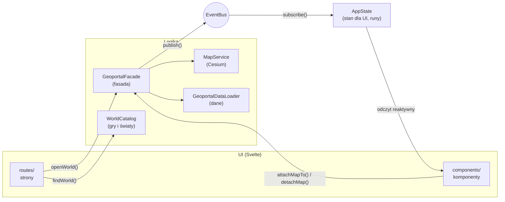
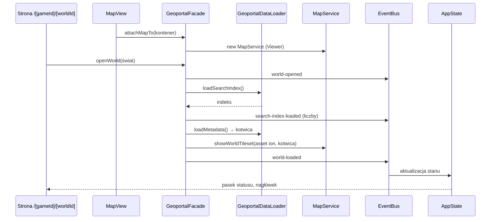

# Architektura

Aplikacja to statyczna strona (SvelteKit, `adapter-static`) działająca wyłącznie w przeglądarce.
Kod dzieli się na warstwy, które znają się tylko w jednym kierunku: **UI nie zna logiki biznesowej,
a logika nie zna UI**. Łączy je fasada (polecenia) i event bus (wyniki).

## Warstwy

| Warstwa    | Folder                                 | Odpowiedzialność                                              | Czego nie robi                                                                   |
| ---------- | -------------------------------------- | ------------------------------------------------------------- | -------------------------------------------------------------------------------- |
| Strony     | `src/routes/`                          | adresy, odczyt parametrów, wybór świata z katalogu            | nie wczytuje danych, nie dotyka Cesium                                           |
| Komponenty | `src/lib/components/`                  | renderowanie stanu, zgłaszanie intencji użytkownika do fasady | nie importuje `cesium`, `minisearch`, `services/`, `data/` (pilnuje tego ESLint) |
| Fasada     | `src/lib/services/geoportal-facade.ts` | jedyne wejście UI do logiki; koordynuje serwisy               | nie zwraca wyników bezpośrednio — publikuje zdarzenia                            |
| Serwisy    | `src/lib/services/`                    | mapa 3D (`MapService`), budowniczy opcji Viewera              | nie znają Svelte                                                                 |
| Dane       | `src/lib/data/`                        | typy, parsowanie i walidacja paczki danych, katalog światów   | nie znają Cesium ani UI                                                          |
| Zdarzenia  | `src/lib/events/`                      | typowany event bus i lista zdarzeń aplikacji                  | —                                                                                |
| Stan       | `src/lib/state/`                       | reaktywny stan dla UI, aktualizowany wyłącznie zdarzeniami    | nie trzyma obiektów Cesium                                                       |

Zależności składa jedno miejsce: `src/lib/composition-root.ts`. Komponenty i strony importują stamtąd
gotowe instancje (`geoportal`, `appState`, `worldCatalog`).

## Przepływ: otwarcie świata

Kolejność `attachMapTo` i `openWorld` nie ma znaczenia — fasada pokaże świat, gdy ma oba.
Każde wczytanie świata dostaje numer pokolenia; wynik wyprzedzonego wczytania (szybka zmiana świata,
odpięcie mapy) jest pomijany, a niepotrzebny tileset niszczony.

## Zdarzenia

Lista w `src/lib/events/app-events.ts`. Zdarzenie to obiekt z polem `type` (unia dyskryminowana),
więc `subscribe('world-load-failed', ({ message }) => …)` ma pełne typy bez asercji.

| Zdarzenie                   | Dane                                                                    | Kiedy                                                                       |
| --------------------------- | ----------------------------------------------------------------------- | --------------------------------------------------------------------------- |
| `world-opened`              | `worldName`                                                             | fasada przełączyła świat                                                    |
| `world-load-started`        | —                                                                       | start wczytywania modelu świata                                             |
| `world-loaded`              | —                                                                       | tileset świata dodany do sceny                                              |
| `world-load-failed`         | `message`                                                               | brak tokenu ion albo błąd wczytywania                                       |
| `search-index-load-started` | —                                                                       | start wczytywania indeksu                                                   |
| `search-index-loaded`       | `counts`                                                                | indeks wczytany; liczba przedmiotów i postaci                               |
| `search-index-load-failed`  | `message`                                                               | błąd pobrania lub walidacji indeksu                                         |
| `tool-selected`             | `toolId` lub `null`                                                     | otwarto albo zamknięto narzędzie na szynie                                  |
| `cursor-moved`              | `position` (E, N, H, lon, lat) lub `null`                               | kursor nad terenem (najwyżej raz na klatkę)                                 |
| `camera-heading-changed`    | `headingDegrees`                                                        | obrót kamery — kompas                                                       |
| `map-scale-changed`         | `metresPerPixel` lub `null`                                             | zmiana skali w środku ekranu — podziałka                                    |
| `coordinate-system-changed` | `systemId`                                                              | zmiana układu współrzędnych w pasku przyrządu                               |
| `search-results-changed`    | `query`, `typeFilter`, `results`                                        | zmiana zapytania, filtra albo wczytanie indeksu                             |
| `search-entry-selected`     | `details` lub `null`                                                    | wybrano wpis (karta szczegółów, znaczniki na mapie) albo wrócono do wyników |
| `data-layers-changed`       | `layers` (nazwa, kolor, liczność, stan)                                 | włączenie, wczytywanie albo błąd warstwy danych                             |
| `data-layer-load-failed`    | `layerName`, `message`                                                  | nie udało się pobrać lub sprawdzić pliku warstwy                            |
| `feature-identified`        | `identification` lub `null`                                             | kliknięto punkt warstwy (karta informacji) albo puste miejsce               |
| `measurement-changed`       | `measurement` (tryb, wierzchołki, podsumowanie, profil, wskazany punkt) | kliknięcie mapy w narzędziu Pomiary, wynik profilu terenu, wyczyszczenie    |

## Cesium a reaktywność Svelte

Obiektów Cesium (`Viewer`, `Cesium3DTileset`, kolekcje) **nie trzymamy w `$state`** — proxy Svelte
psuje ich wewnętrzne mechanizmy. Żyją w zwykłych polach `MapService`. Reaktywne są tylko dane
aplikacji w `AppState`.

## Wzorce

- **Fasada** — `GeoportalFacade`: prosty interfejs (`openWorld`, `attachMapTo`, `detachMap`) zamiast
  wielu serwisów.
- **Budowniczy** — `ViewerOptionsBuilder`: czytelne składanie opcji Viewera
  (`withoutIonBaseLayer().withoutToolbarWidgets()…`).
- **Obserwator** — `EventBus`: wyniki płyną od logiki do stanu bez wzajemnej znajomości.
- **Korzeń kompozycji** — `composition-root.ts`: jedno miejsce tworzenia i łączenia obiektów;
  zależności przekazywane konstruktorem, co ułatwia testy.

## Geodezja

`WorldFrame` przelicza punkt sceny Cesium na pozycję w świecie: E/N/H w metrach od kotwicy oraz lon/lat.
`CoordinateFormatter` pokazuje ją w jednym z układów: **Układ Khorinis 1992** (metry), **jednostki gry**
(centymetry silnika: x = E, y = H, z = −N — te same co w komendzie Marvina `goto pos`) albo **WGS 84**.

## Wyszukiwanie

`SearchCoordinator` (wywoływany przez fasadę) trzyma zapytanie, filtr i wybrany wpis jednego świata.
`SearchService` to indeks MiniSearch: pola nazwa, kategoria (z nazwą gildii zamiast kodu, np. VLK →
Mieszczanin) i kod; wyszukiwanie po początku słowa, z tolerancją literówek w dłuższych słowach i bez
polskich znaków (`normalizeSearchTerm`). `SearchEntryPresenter` zamienia wpisy na teksty dla UI,
a `PlaceMarkersLayer` rysuje miejsca wybranego wpisu jako jedną kolekcję punktów Cesium.

Wybrany wpis jest w adresie: `/g2nk/khorinis?wpis=item:ITPL_PERM_HERB`. Wpis z linku czeka na
wczytanie indeksu, a po wczytaniu modelu świata kamera leci do jego miejsc.

## Warstwy danych i identyfikacja

`DATA_LAYERS` (`services/layers/data-layer-catalog.ts`) opisuje warstwy: przedmioty w świecie, skrzynie,
unikatowe postacie, wszyscy NPC — plik GeoJSON, kolor, parser właściwości i opis obiektu do karty.
`DataLayersCoordinator` pobiera plik dopiero przy pierwszym włączeniu warstwy i go zapamiętuje.
`DataLayersRenderer` rysuje każdą warstwę jako kolekcję punktów, której identyfikatorem jest
`{ layerId, featureIndex }`; kliknięcie mapy (`MapViewObserver` → `onMapClicked`) wskazuje obiekt
w danych bez dodatkowych map, a fasada publikuje `feature-identified`.

## Pomiary

Gdy aktywne jest narzędzie Pomiary, fasada kieruje kliknięcia mapy do `MeasurementCoordinator`
zamiast do identyfikacji. Tryb **Odległość** zbiera wierzchołki łamanej; `MeasurementCalculator`
liczy odległość w poziomie i w przestrzeni, a profil terenu powstaje z próbek co ~2 m rzutowanych
na model świata (`MapService.sampleTerrainUnder` → `clampToHeightMostDetailed`). Model zawiera drzewa
i dachy, więc przed liczeniem profilu wysokości przechodzą przez filtr medianowy
(`removeNarrowObstacles`), który usuwa wąskie przeszkody; gęsty las nadal może podnieść profil.
Tryb **Współrzędne** pokazuje wskazany punkt we wszystkich układach i komendę Marvina `goto pos`.
