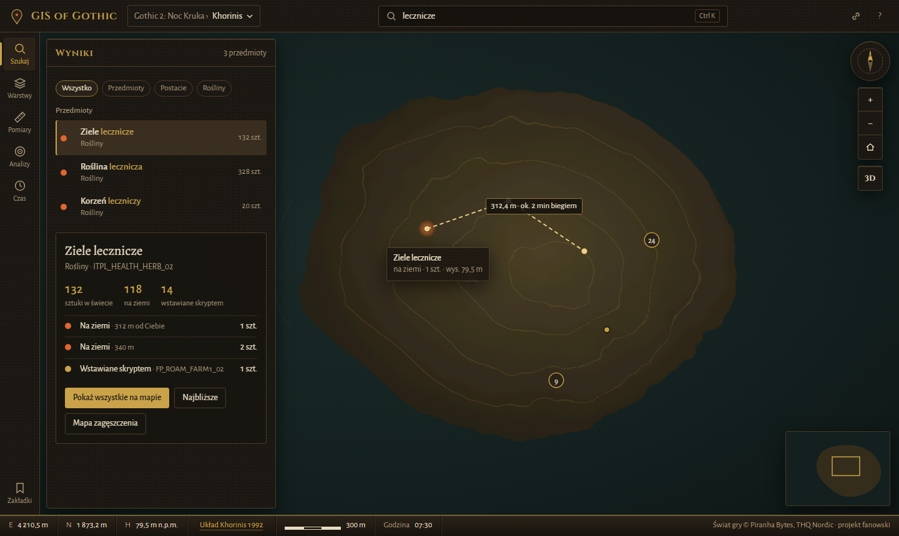
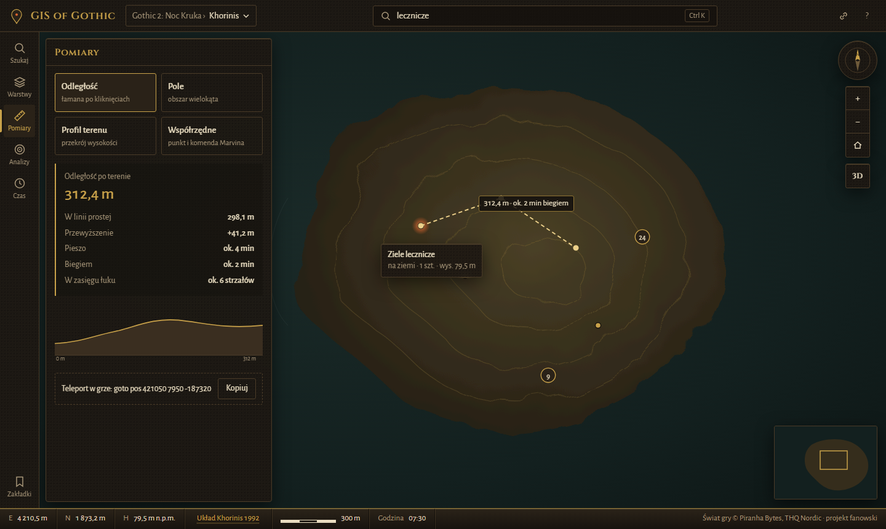
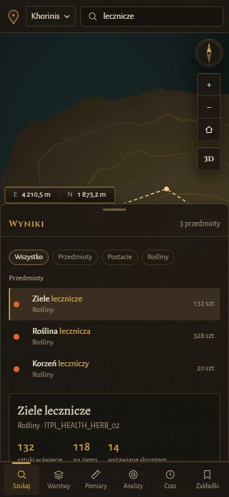

# Projekt interfejsu

Makieta: [`docs/projekt-ui/makieta.html`](projekt-ui/makieta.html) (otwórz w przeglądarce; panele
przełącza szyna narzędzi, `#measure`, `#layers` itd. w adresie otwiera konkretny panel).

| Wyszukiwarka                             | Pomiary                              | Telefon                             |
| ---------------------------------------- | ------------------------------------ | ----------------------------------- |
|  |  |  |

Teren na makiecie to rysunek zastępczy — w aplikacji jest model 3D z Cesium ion.

## Koncepcja

**Poważny geoportal o niepoważnym świecie.** Interfejs zachowuje się jak prawdziwe narzędzie
GIS (Geoportal, ArcGIS, Google Earth): pasek wyszukiwania, warstwy, pomiary, układ współrzędnych,
skala, mapa przeglądowa, atrybucja. Humor siedzi wyłącznie w treści i jednostkach — nigdy w obsłudze.

Zasady humoru:

- **Najpierw prawdziwa wartość, potem żart.** „312,4 m” jest zawsze pierwsze i największe;
  „ok. 6 strzałów z łuku” to dodatkowy wiersz przeliczeń.
- Żarty to terminologia geodezyjna przeniesiona na świat gry: „Układ Khorinis 1992”, „m n.p.m.”
  (morza wokół wyspy), widoczność jako „czy straż mnie widzi?”.
- Żart nie może kłamać: przeliczenia (krok, bieg, strzał) liczymy z prawdziwych parametrów gry.
- Żadnych grafik ani logo z gry.

## Tokeny

| Rola                           | Wartość                          |
| ------------------------------ | -------------------------------- |
| Sadza (tło)                    | `#14110d`                        |
| Kamień (panele)                | `#1d1812`, `#2a2218`             |
| Kuta krawędź                   | `#4a3b28`, refleks `#6e5a3a`     |
| Mosiądz (akcent, aktywny stan) | `#c9a24a`, przygaszony `#8f7333` |
| Żar (wyniki na mapie)          | `#e0662f` → `#ffd27a`            |
| Rdza (błędy, zniszczenie)      | `#8b3a2b`                        |
| Pergamin (tekst)               | `#e8dcc0`, przygaszony `#a8977a` |
| Morze                          | `#13201f`                        |

Kolory rodzajów miejsc (spójne w liście, legendzie i na mapie): na ziemi — żar, wstawiane
skryptem — mosiądz, w skrzyni — zielonkawy szary `#8aa3a0`, u NPC — fiolet `#b07ad0`.

Typografia: **Cinzel** tylko w nazwie aplikacji i tytułach paneli; **Alegreya** (szeryf) w nazwach
wpisów na kartach szczegółów; **Alegreya Sans** w całym UI. Liczby zawsze z cyframi tabelarycznymi
(`font-variant-numeric: tabular-nums`), bez kroju monospace.

Kształt: zaokrąglenia 3–4 px, cienkie „kute” ramki z jaśniejszą górną krawędzią, panele półprzezroczyste
z ziarnem CSS.

## Układ (komputer)

```
┌──────────────────────────────────────────────────────────────────────────────┐
│ ⚲ GIS of Gothic │ Gothic 2: NK › Khorinis ▾ │   [ ⌕ Szukaj…       Ctrl K ]  ⛓ ? │  pasek górny
├────┬──────────────────┬──────────────────────────────────────────────┬───────┤
│ ⌕  │ PANEL NARZĘDZIA  │                                              │  🧭   │
│ ≋  │ (wyniki, karta,  │                 MAPA 3D                      │  + −  │
│ 📏 │  warstwy, …)     │                                              │  ⌂    │
│ ◎  │                  │                                              │  3D   │
│ ◷  │                  │                                              │ ┌───┐ │
│    │                  │                                              │ └───┘ │ mapa przeglądowa
│ 🔖 │                  │                                              │       │
├────┴──────────────────┴──────────────────────────────────────────────┴───────┤
│ E 4 210,5 m │ N 1 873,2 m │ H 79,5 m n.p.m. │ Układ Khorinis 1992 │ ▬▬ 300 m │…│  pasek przyrządu
└──────────────────────────────────────────────────────────────────────────────┘
```

- **Szyna narzędzi** (lewa): Szukaj, Warstwy, Pomiary, Analizy, Czas; Zakładki na dole. Jedno
  narzędzie otwarte naraz; ponowne kliknięcie zamyka panel. Aktywne narzędzie — mosiężny znacznik.
- **Panel narzędzia** (368 px): treść zależy od narzędzia, przewija się niezależnie od mapy.
- **Kontrolki mapy** (prawa): kompas (klik = północ), przybliż/oddal, cały świat, 2D/3D.
- **Pasek przyrządu** (dół) — element rozpoznawczy: mosiężna listwa jak w instrumencie
  geodezyjnym; pozycja kursora, wysokość, układ współrzędnych (klik = zmiana), skala, godzina w grze,
  atrybucja praw.
- Wyszukiwarka zawsze w pasku górnym (`Ctrl K` z dowolnego miejsca); wyniki w panelu Szukaj.

## Układ (telefon)

- Pasek górny: ikona, przełącznik świata, wyszukiwarka.
- Szyna narzędzi zmienia się w **dolną nawigację** (6 przycisków).
- Panel narzędzia to **arkusz od dołu** (`drawer`) z uchwytem: zwinięty / połowa ekranu / pełny.
- Pasek przyrządu skraca się do E/N w pigułce nad arkuszem; reszta w panelu Pomiary.
- Kontrolki mapy zostają po prawej, mapa przeglądowa znika.

## Narzędzia

| Narzędzie           | Funkcje                                                                                                                                                                                     | Etap                       |
| ------------------- | ------------------------------------------------------------------------------------------------------------------------------------------------------------------------------------------- | -------------------------- |
| **Szukaj**          | podpowiedzi z kategorią i liczbą sztuk; filtry rodzaju; karta szczegółów (fakty, lista miejsc z odległością, skrzynie z kluczem, rutyna postaci); „pokaż wszystkie na mapie”; link do wpisu | v1                         |
| **Warstwy**         | podkład: Teren 3D / Poziomice / Pergamin; warstwy danych (przedmioty, skrzynie, unikatowe postacie, wszyscy NPC), podfiltry, liczności; siatka, waypointy; questy „wkrótce”                 | v1: dane; podkłady później |
| **Pomiary**         | odległość (po terenie i w linii prostej, przewyższenie, przeliczenia: pieszo, biegiem, strzały z łuku); pole; profil terenu; współrzędne punktu i komenda Marvina `goto pos` do skopiowania | v1: odległość, współrzędne |
| **Analizy**         | najbliższe wystąpienia od punktu; zasięg (bufor); mapa zagęszczenia; widoczność z punktu                                                                                                    | po v1                      |
| **Czas i rozdział** | suwak godziny (postacie tam, gdzie są o tej porze, światło jak w grze), wybór rozdziału I–VI                                                                                                | v1: godzina dla rutyn      |
| **Zakładki**        | zapis widoku, link do udostępnienia                                                                                                                                                         | po v1                      |

Stan widoku (świat, wybrany wpis, narzędzie, kamera) trafia do adresu URL — każdy widok da się wysłać.

## Teksty

- Etykiety po polsku, zdaniowe („Pokaż wszystkie na mapie”, nie „POKAŻ”). Przycisk nazywa skutek.
- Kody gildii zamieniamy na nazwy (VLK → Mieszczanin, MIL → Straż, SLD → Najemnik, KDF → Mag Ognia…);
  kod instancji (`ITPL_HEALTH_HERB_02`) zostaje drobnym drugim planem dla wtajemniczonych.
- Puste i błędne stany mówią, co zrobić: „Nic nie znaleziono. Spróbuj krótszej nazwy albo innej kategorii.”

## Dostępność i wydajność

- Pełna obsługa klawiaturą: szyna i panele jako przyciski z `aria-pressed`, widoczny fokus (mosiężny
  obrys), `Esc` zamyka panel, `Ctrl K` — wyszukiwarka.
- Kontrast tekstu pergaminowego na kamieniu ≥ 7:1; kolory rodzajów miejsc zawsze z etykietą.
- `prefers-reduced-motion`: przeloty kamery skrócone do przeskoku.
- Markery jako jedna kolekcja Cesium (`BillboardCollection`/`PointPrimitiveCollection`) z klastrowaniem;
  wyszukiwanie (MiniSearch) w Web Workerze przy dużych indeksach; panele nie renderują się, gdy zamknięte.

## Architektura UI

Zgodnie z [architektura.md](architektura.md):

- Każde narzędzie mapy to klasa implementująca wspólny interfejs (`MapTool`: `activate`, `deactivate`,
  obsługa kliknięć), rejestrowana w `MapToolRegistry` — fasada włącza narzędzie po identyfikatorze.
- Panel narzędzia to komponent Svelte, który czyta stan (`AppState`) i wywołuje fasadę; wyniki pomiarów
  i analiz wracają zdarzeniami (`measurement-updated`, `search-results-changed`…).
- Szyna, panele i arkusz mobilny to wspólne komponenty layoutu (`ToolRail`, `ToolPanel`, `MapControls`,
  `InstrumentBar`) — nowe narzędzie to wpis w rejestrze, klasa i komponent panelu.
